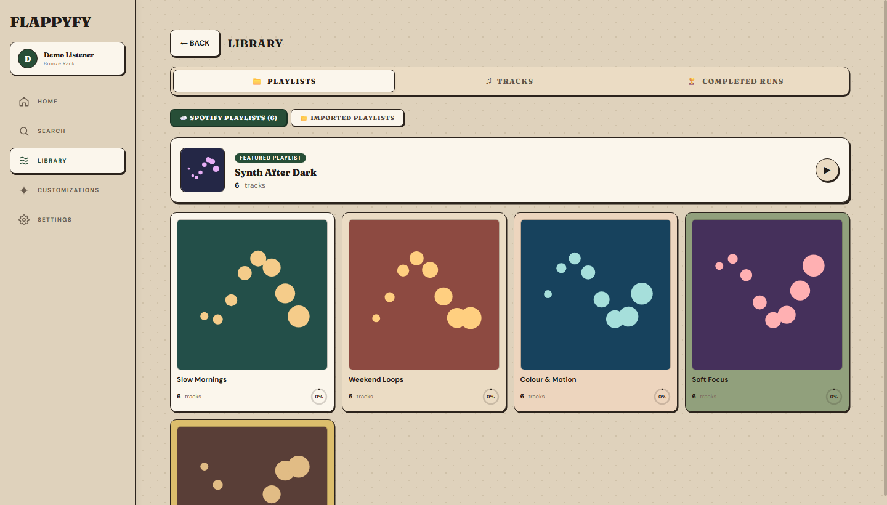
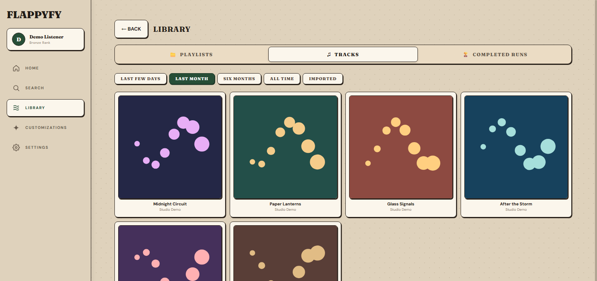
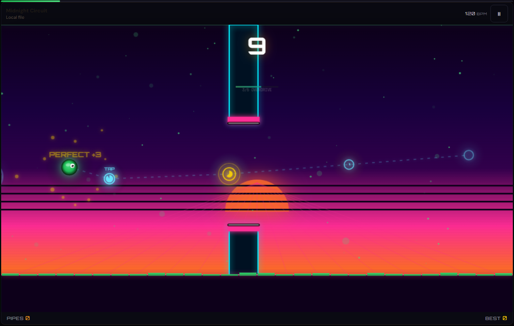
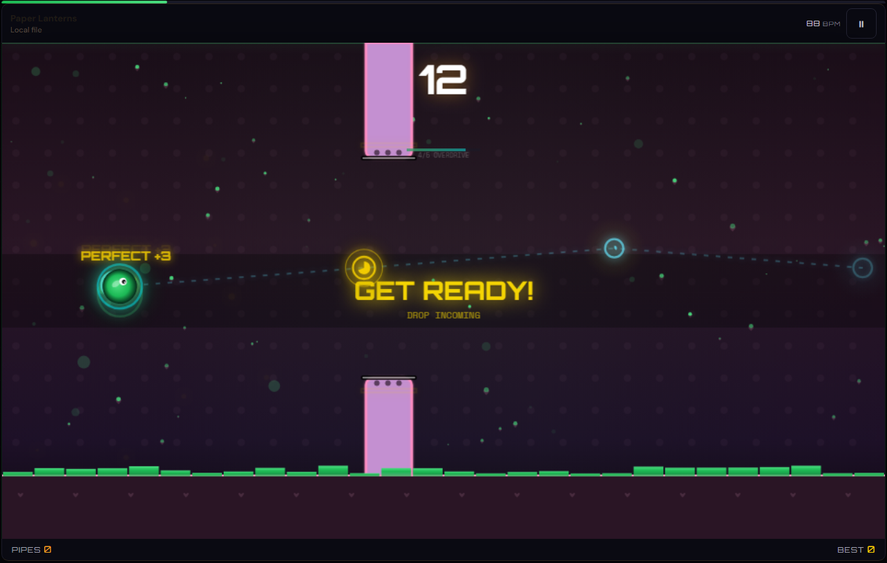
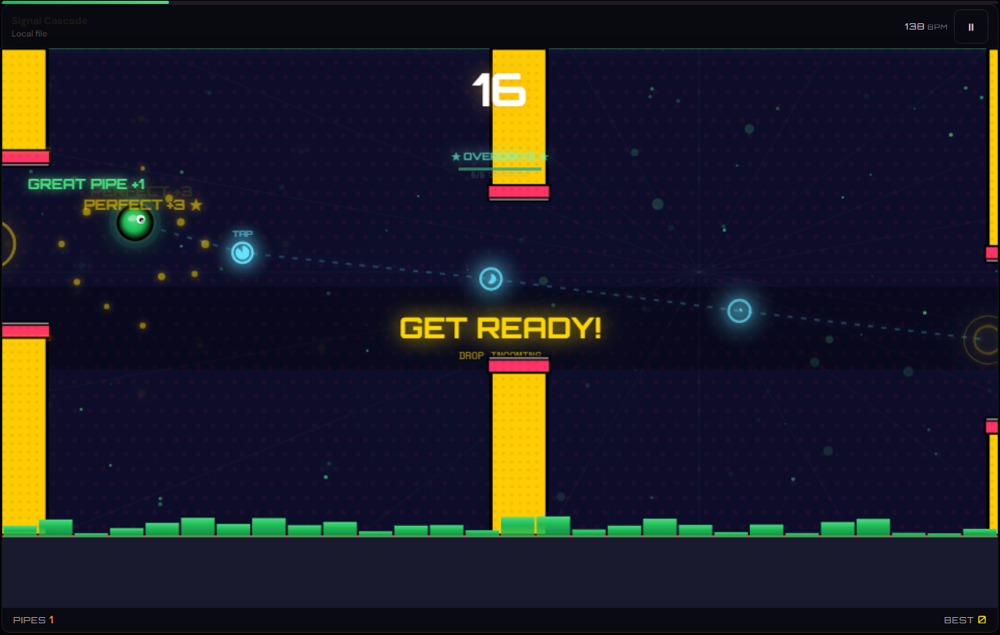
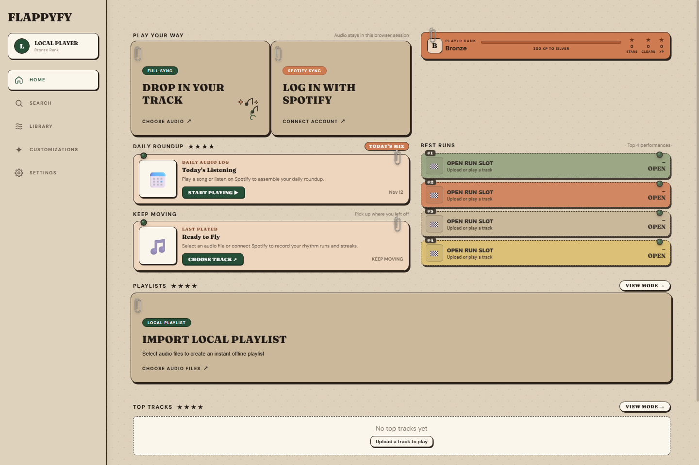
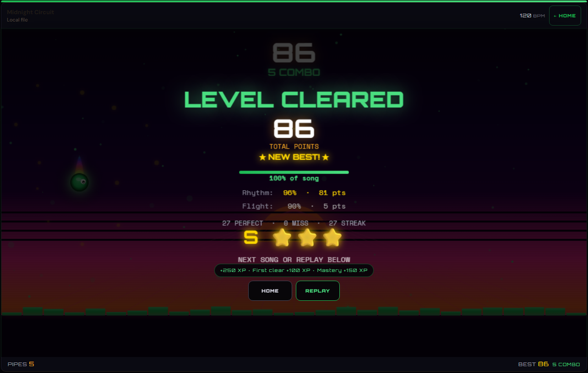

# Flappyfy

Flappyfy is a browser rhythm game built around the music you listen to. The Spotify prototype brings your playlists, top tracks, and recent listening into the game. You can also pick a song from your device. Tap to collect rhythm targets and fly through pipes until the track ends.

## Spotify listening

- **Library** brings together your Spotify playlists, recent tracks, and top tracks from different listening periods.
- **Search** finds songs in the Spotify catalog. **Daily Roundup** combines recent Spotify listening with tracks you’ve played in Flappyfy.
- **Playlist journeys** let you clear tracks one at a time, earn XP at chapter checkpoints, and resume where you left off.

| Spotify playlists | Recent listening |
| --- | --- |
|  |  |

These screens show the running app with sample Spotify data. The catalog playback prototype uses the Spotify Web Playback SDK and requires Premium, an authorized developer app, and a matching redirect URI. The track screen identifies whether timing comes from analysis, a preview, available tempo data, or an estimate. Copy [`.env.example`](.env.example) to `.env` to configure the integration. See the [Spotify connection screen](docs/screenshots/spotify-connect.png) and the [Spotify Developer Policy](https://developer.spotify.com/policy).

Last.fm listening profiles can also inform recommendations when a `VITE_LASTFM_API_KEY` is configured.

## Level designs

Tracks can open on different flight paths even at the same tempo. The path switches between rolling arcs, climbs, and shorter turns as the song moves through sections. Easy, Normal, and Hard vary pipe openings, approach times, and hit windows. In-game themes also change the look of the stage and its pipes.

**Neon Synthwave · Normal**



| K-Pop Kawaii · Easy | Pop-Art Comic · Hard |
| --- | --- |
|  |  |

Gameplay screenshots show three generated test tracks played through the web build.

## Play locally

You’ll need Node.js 22 or newer and npm.

```sh
npm ci
npm run dev
```

Open `http://127.0.0.1:5173/`. Choose **Log in with Spotify** for the configured prototype, or **Drop in your track** for a file your browser can decode. Choose **Start Run**, then tap the play area or press **Space** to flap. Use the pause button or **Esc** to pause. On a phone, rotate to landscape for the full play area.

- Perfect, Great, and Good rhythm hits earn **3, 2, and 1 point** respectively. Each cleared pipe earns **1 point**.
- The results screen breaks down rhythm accuracy, flight accuracy, song completion, grade, and XP. Personal bests, track mastery, and playlist progress are saved in the browser.
- Audio playback and analysis stay in the browser session. The app can look up track metadata using information from the file. Re-select a local audio file to replay it in a new session.

| Home | Results |
| --- | --- |
|  |  |

## Build and install

```sh
npm test
npm run build
npm run preview
```

The production build is in `dist/`. Serve that directory over HTTPS and open it in Android Chrome to install it from the browser menu.

To test the local preview in an Android Studio emulator, run `adb reverse tcp:4173 tcp:4173` and open `http://127.0.0.1:4173/` inside the emulator.

## Project structure

| Path | Purpose |
| --- | --- |
| `src/game/` | Audio analysis, rhythm maps, timing, scoring, progression, rendering, and game audio |
| `src/menu/` and `src/settings/` | Home, library, search, playlists, and customization |
| `src/services/` | Browser storage and music integrations |
| `public/` | Web app manifest and install icons |
| `test/` | Node.js tests |
| `docs/screenshots/` | Screenshots from the production build |
